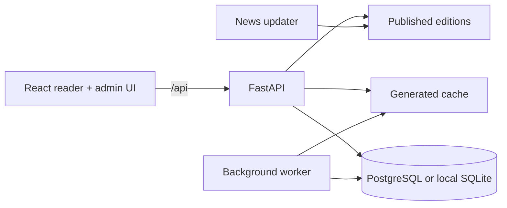

# NewsSense application

> Start with the visual [project overview](../README.md). This guide covers the web application, API and local development.

## Runtime map



| Directory | Responsibility |
| --- | --- |
| `app/api/endpoints` | HTTP routes for news, chat, admin, health, reports and notifications |
| `app/services` | Reader-facing business logic and background generation |
| `app/core` | Auth, database, budgets, jobs, monitoring and object storage |
| `web/src/pages` | Home, article, digest, search, saved, trends, AI models and admin screens |
| `web/src/components` | Shared reader, article, chat, model and layout components |
| `static` | Published article JSON, images, audio and updater status |
| `tests` | FastAPI and core service tests |

## Run without Docker

From `apps/`, use two terminals:

```powershell
# API
python -m venv .venv
.venv\Scripts\python -m pip install -r requirements.txt
.venv\Scripts\python -m uvicorn app.main:app --reload --port 8000
```

```powershell
# UI
cd web
npm ci
npm run dev
```

Vite runs at [http://localhost:5173](http://localhost:5173) and proxies development API requests to port 8000. Settings load from the repository-level `.env`; copy [`.env.example`](../.env.example) to begin.

## Run with Docker

```powershell
docker compose up --build
```

The local stack starts the web proxy, backend, worker and PostgreSQL. The updater is an optional profile:

```powershell
docker compose --profile updates up -d --build
```

For the split $0 cloud setup, follow the [free-tier deployment guide](../deployment/free-tier/README.md).

## Populate news

Run from the repository root. Source briefs need no AI key and usually finish much faster than fully generated reports:

```powershell
python -m pip install -r requirements/quick_news.txt
python pipeline/daily_update.py --interval 60 --once --source-briefs --per-category 1 --per-feed 3 --no-full-text --no-images --no-audio
```

For verified AI-written reports, configure one provider key, model token prices and positive daily/monthly currency limits. Then omit `--source-briefs` and `--no-checks`. Failed checks enter the editorial hold queue; the previous edition stays published if the run fails.

## Administrator setup

The strong `ADMIN_TOKEN` can bootstrap a new deployment. Create a named account from a trusted shell as soon as PostgreSQL is available:

```powershell
$env:ADMIN_NEW_PASSWORD = 'a unique password from your password manager'
.venv\Scripts\python scripts/admin_account.py create owner --role owner --with-mfa
Remove-Item Env:ADMIN_NEW_PASSWORD
```

Roles are `owner`, `editor` and `viewer`. Named sessions use HTTP-only cookies and owners must enable TOTP MFA before production readiness passes. Keep `ALLOW_LEGACY_ADMIN_TOKEN=false` after named accounts exist.

## Tests

```powershell
# From apps/
.venv\Scripts\python -m pytest tests

# From apps/web/
npm run lint
npm test
npm run build
```

Playwright covers complete browser journeys:

```powershell
cd web
npx playwright install chromium
$env:PYTHON = '..\.venv\Scripts\python.exe'
npm run test:e2e
```

## Operational endpoints

| Endpoint | Purpose |
| --- | --- |
| `/api/health/live` | Process liveness for the hosting platform |
| `/api/health/ready` | Database, storage, publication freshness and production configuration |
| `/api/health/metrics` | Token-protected Prometheus metrics |
| `/api/storage/sync` | Token-protected pull from signed object storage after an external update |
| `/api/admin/*` | Authenticated accounts, editorial controls, budgets and operations |

Object storage publishes files first and replaces the signed manifest last. The API downloads only manifest-listed files and verifies size, SHA-256 digest and HMAC signature before replacing local content.
