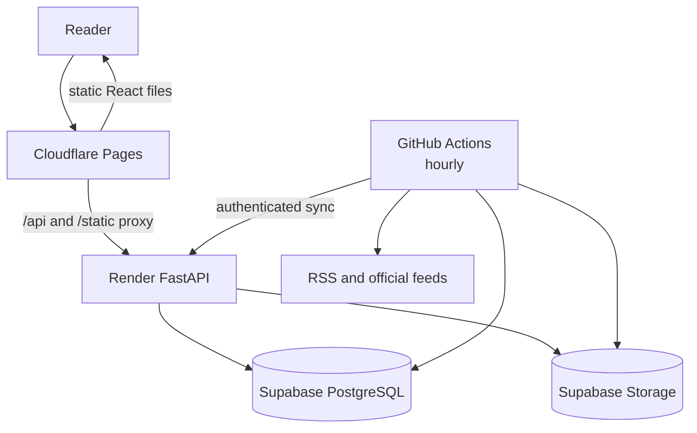

# $0 deployment: Cloudflare + Render + Supabase

This is the prepared staging layout for NewsSense. It separates the services so no personal computer or open terminal is needed after deployment.



## Before you begin

Create free accounts for Cloudflare, Render and Supabase. Keep the GitHub repository public so scheduled standard GitHub-hosted runners remain free. Do not add an AI provider key during the first deployment; the scheduled workflow publishes attributed source briefs without paid model calls.

Generate the three independent secrets locally. Save the values in a password manager; do not commit them.

```powershell
python -c "import secrets; print('MANIFEST=' + secrets.token_urlsafe(48)); print('SYNC=' + secrets.token_urlsafe(48)); print('DB=' + secrets.token_urlsafe(32))"
```

## 1. Create the Supabase project

1. Create one Free project and choose a region near your readers.
2. Use the generated `DB` value as the database password when the project is created.
3. Open **Project Settings → Database** and copy the pooled PostgreSQL connection string. Replace its password placeholder with the real password. This becomes `DATABASE_URL`.
4. Open **Storage** and create a private bucket named `newssense`.
5. Open **Project Settings → Storage → S3 Access Keys** and create an access key.
6. Record the S3 endpoint, region, access-key ID and secret access key.

The bucket stays private. The updater and API use the S3 credential; readers receive media through the application.

## 2. Deploy the Render backend

1. In Render choose **New → Blueprint** and connect this GitHub repository.
2. Render detects the root [render.yaml](../../../render.yaml) and creates `newssense-api` on the Free plan.
3. Enter the environment variables marked as manual:

| Variable | Value |
| --- | --- |
| `DATABASE_URL` | Supabase pooled PostgreSQL connection string |
| `PUBLIC_BASE_URL` | Temporary Cloudflare Pages URL after step 3; use `https://placeholder.pages.dev` for the first build |
| `ALLOWED_ORIGINS` | Same public Cloudflare URL |
| `ALLOWED_HOSTS` | Render hostname and Cloudflare hostname, comma separated |
| `OBJECT_STORAGE_BUCKET` | `newssense` |
| `OBJECT_STORAGE_REGION` | Supabase S3 region |
| `OBJECT_STORAGE_ENDPOINT` | Supabase S3 endpoint |
| `OBJECT_STORAGE_ACCESS_KEY_ID` | Supabase S3 access-key ID |
| `OBJECT_STORAGE_SECRET_ACCESS_KEY` | Supabase S3 secret access key |
| `OBJECT_STORAGE_MANIFEST_KEY` | Generated `MANIFEST` value |
| `STORAGE_SYNC_TOKEN` | Generated `SYNC` value |

Render generates `ADMIN_TOKEN` and `METRICS_TOKEN`. Reveal and save the admin token after the first deployment. Never put these values in GitHub code or Cloudflare client-side variables.

The first deployment can report `not_ready` until the first edition is published. Liveness at `/api/health/live` should still return HTTP 200.

## 3. Deploy the Cloudflare Pages frontend

1. In Cloudflare choose **Workers & Pages → Create → Pages → Connect to Git**.
2. Select this repository and use:

| Setting | Value |
| --- | --- |
| Root directory | `LLM-News/apps/web` |
| Build command | `npm ci && npm run build` |
| Build output directory | `dist` |
| Node version | `22` |

3. In **Settings → Variables and Secrets**, add server-side variable `BACKEND_ORIGIN` with the Render origin, for example `https://newssense-api.onrender.com`.
4. Deploy and record the assigned `https://…pages.dev` URL.
5. Return to Render and replace the placeholder `PUBLIC_BASE_URL` and `ALLOWED_ORIGINS`. Set `ALLOWED_HOSTS` to both hostnames without `https://`.

The Pages Function in `apps/web/functions/[[path]].ts` forwards only the routes declared in `apps/web/public/_routes.json`. Secrets remain on the server side.

## 4. Configure the hourly updater

In GitHub open **Settings → Secrets and variables → Actions** and create these repository secrets:

| Secret | Copy from |
| --- | --- |
| `DATABASE_URL` | Supabase pooled connection string |
| `OBJECT_STORAGE_BUCKET` | `newssense` |
| `OBJECT_STORAGE_REGION` | Supabase S3 settings |
| `OBJECT_STORAGE_ENDPOINT` | Supabase S3 settings |
| `OBJECT_STORAGE_ACCESS_KEY_ID` | Supabase S3 access key |
| `OBJECT_STORAGE_SECRET_ACCESS_KEY` | Supabase S3 secret key |
| `OBJECT_STORAGE_MANIFEST_KEY` | Same `MANIFEST` value used by Render |
| `BACKEND_ORIGIN` | Render origin |
| `STORAGE_SYNC_TOKEN` | Same `SYNC` value used by Render |

Open **Actions → Update news → Run workflow**. A successful run must complete all three publication steps: build the source briefs, upload the final signed manifest and refresh the API. After that test passes, create repository variable `NEWS_UPDATES_ENABLED=true`. The recurring schedule runs at minute 17 of every hour; it stays disabled until that variable exists.

Verify:

```text
https://YOUR-PAGES-DOMAIN/api/health
https://YOUR-PAGES-DOMAIN/api/health/ready
https://YOUR-PAGES-DOMAIN/feed.xml
```

The home page should stop showing “update delayed” after the workflow publishes and the API pulls the first edition.

## 5. Create the named owner account

The generated admin token provides initial access. From a trusted Render shell, create the permanent owner account and MFA secret:

```bash
export ADMIN_NEW_PASSWORD='use-a-unique-password-from-your-manager'
python scripts/admin_account.py create owner --role owner --with-mfa
unset ADMIN_NEW_PASSWORD
```

Add the displayed TOTP URI to an authenticator, sign in as the owner and confirm MFA works. Then remove the legacy `ADMIN_TOKEN` or keep `ALLOW_LEGACY_ADMIN_TOKEN=false`. If a free hosting plan does not provide a shell, create this account locally against the same `DATABASE_URL`, then immediately remove the database secret from the local terminal history.

## 6. Launch checks

- Run the GitHub updater twice and confirm the second run does not duplicate stories.
- Confirm `/api/health/ready` returns 200 and reports fresh news.
- Confirm article images, saved stories, search and the model comparison page on mobile.
- Confirm the admin route rejects incorrect credentials and records successful actions.
- Trigger one staging backup, restore it to a separate project and compare article counts.
- Add a custom domain only after the Pages URL works; then update `PUBLIC_BASE_URL`, `ALLOWED_ORIGINS` and `ALLOWED_HOSTS`.
- Enable Sentry, email, Web Push or an AI provider only when their credentials and spending limits are ready.

## Free-tier behavior

The Render service can sleep when idle, so the first request may take longer. GitHub schedules may begin several minutes after their nominal minute. Free products also have usage and inactivity limits. Keep billing disabled, review each provider dashboard monthly and move to a paid plan only after traffic requires it.

Your PC is not involved after these four services are configured.
