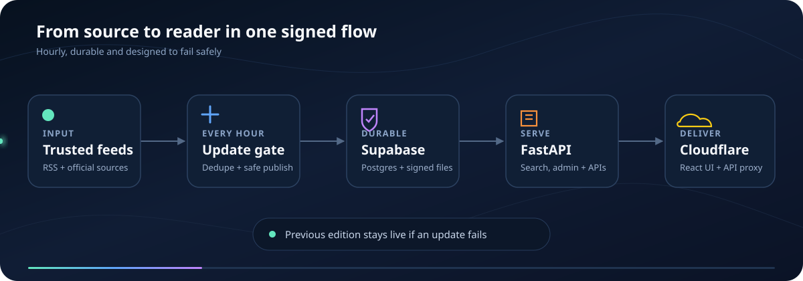
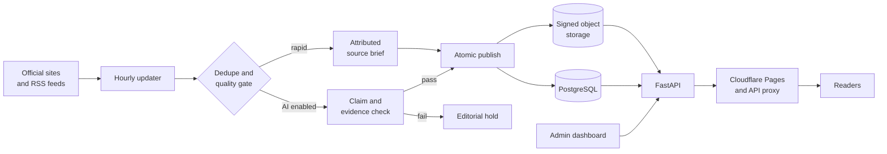
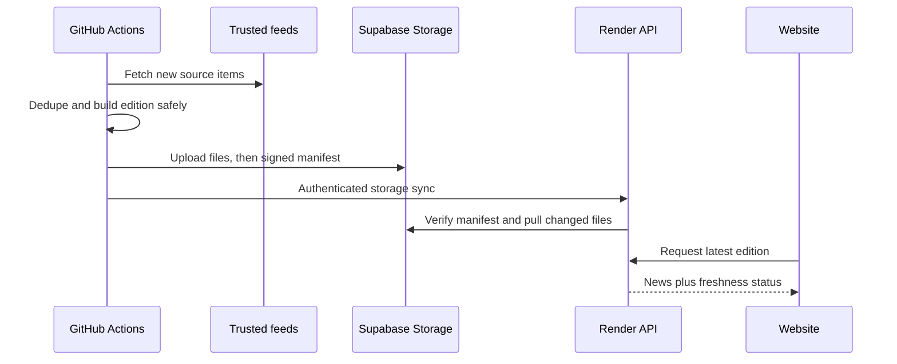

<div align="center">

# NewsSense

### AI news with visible evidence, model intelligence and safer publishing

One newsroom for AI releases, research, policy, infrastructure and model comparisons—built so readers can see what is verified, what is a rapid source brief and where every claim came from.


</div>



## What you see

| Newsroom | Model intelligence | Trust and operations |
| --- | --- | --- |
| Topic editions, breaking briefs and archive search | Price, context window and benchmark comparisons | Claim evidence, source diversity and correction history |
| Personal digest, saved stories and follow-ups | Decision studio and shareable comparison URLs | Named admin roles, MFA and an audit log |
| Audio, translation and article chat | Release, price-change and model alerts | Spending limits, feed health, stale-news warnings and backups |

Rapid briefs are copied from attributed source feeds and labelled as source briefs. AI-written reports go through claim checking before publication. A failed update never erases the last good edition.

## The system at a glance





## Architecture

```text
LLM-NEWS-/
├── LLM-News/
│   ├── apps/
│   │   ├── app/             FastAPI endpoints, services, auth and operations
│   │   ├── web/             React 19 + TypeScript reader and admin UI
│   │   ├── static/          Published editions and media
│   │   └── tests/           Backend tests
│   ├── pipeline/            Feed ingestion, grouping, checks and safe publishing
│   ├── deployment/          Free-tier guide, backup and deployment helpers
│   ├── requirements/        Pipeline dependency sets
│   └── tests/               Pipeline tests
├── .github/workflows/       CI, deployment and hourly updater automation
└── render.yaml              Render backend blueprint
```

The browser uses one public origin. Cloudflare Pages serves the compiled React app and forwards API, media, feed and sitemap routes to FastAPI. This keeps secure cookies and sharing URLs simple even though the frontend and backend run on separate free services.

## Run locally

Requirements: Python 3.11+, Node.js 22+ and npm.

```powershell
git clone https://github.com/manavaghera/LLM-NEWS-.git
cd LLM-NEWS-/LLM-News/apps
Copy-Item ../.env.example ../.env

# Terminal 1 — API
python -m venv .venv
.venv\Scripts\python -m pip install -r requirements.txt
.venv\Scripts\python -m uvicorn app.main:app --reload --port 8000

# Terminal 2 — web
cd web
npm ci
npm run dev
```

Open [http://localhost:5173](http://localhost:5173). To populate a quick local edition without paid AI:

```powershell
cd ..
python -m pip install -r requirements/quick_news.txt
python pipeline/daily_update.py --interval 60 --once --source-briefs --per-category 1 --no-full-text --no-images --no-audio
```

Docker remains available for a full local stack:

```powershell
cd apps
docker compose up --build
```

## Deploy for $0

The prepared free-tier path uses:

- **Cloudflare Pages** for the static frontend and same-origin API proxy.
- **Render Free** for the FastAPI web service.
- **Supabase Free** for PostgreSQL and S3-compatible article/media storage.
- **GitHub Actions** for hourly, source-only news updates.

No AI provider key is required for the hourly source briefs. Optional AI reports, audio and email can be enabled later with explicit provider limits. Free services have sleep and usage limits, so this setup suits staging and an early public launch rather than guaranteed high traffic.

Follow the exact checklist in **[the free-tier deployment guide](LLM-News/deployment/free-tier/README.md)**.

## Accuracy and failure safety

- Every published article stores its source items and links.
- Headlines, summaries, body claims and speech text are included in verification.
- Malformed verifier output fails closed and weak reports enter the editorial queue.
- Editions publish through a temporary directory and atomic swap.
- Concurrent updaters share a database lease, preventing duplicate generation.
- Object-storage manifests are signed and every restored file is hash checked.
- Readiness becomes unhealthy when the edition is stale or the database is unavailable.
- Currency and call limits stop configured AI providers before budget exhaustion.

## Quality checks

```powershell
# Backend and pipeline
LLM-News\apps\.venv\Scripts\python -m pytest LLM-News/apps/tests LLM-News/tests

# Frontend
cd LLM-News/apps/web
npm run lint
npm test
npm run build
```

Playwright tests live in `LLM-News/apps/web/e2e` for the main reader and admin journeys.

## Documentation

- [Application and developer guide](LLM-News/apps/README.md)
- [Free-tier deployment](LLM-News/deployment/free-tier/README.md)
- [Oracle deployment alternative](LLM-News/deployment/oracle-cloud/README.md)
- [Environment template](LLM-News/.env.example)

## License

Released under the [MIT License](LLM-News/LICENSE).
